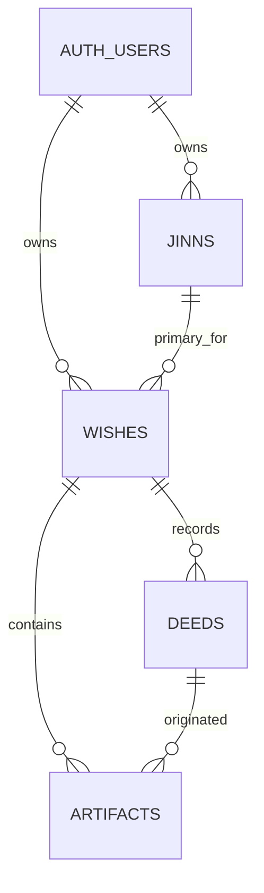

# JINN-F03-001 — foundation reset and hosted cutover packet

Status: implementation and local rehearsal only. **No hosted database migration, bucket deletion, merge, or deploy is authorized by this PR.** The canonical fresh-install migration is `supabase/migrations/20261115201523_f03_domain_neutral_baseline.sql`. Previously applied migrations are archived without editing in `supabase/legacy-migrations`; historical vertical product notes are in `docs/legacy`.

## Architecture

`auth.users` remains Supabase-managed. One verified user may own multiple Jinns; a partial unique index selects at most one primary Jinn. The first-save path creates it if needed. The Wish has no kind, mission ID, three-slot cap, or category-based deduplication. Deeds preserve the complete history of AI preparation and do not claim external execution. Artifacts use a fixed `structured_draft` grammar with `document`, `checklist`, and `questions` components, source note, unknowns, next Deed and boundary. React renders the workspace from Wish, Deed and Artifact rows. Corrections use an optimistic version; the next Deed uses the saved source note.

## Legacy → new inventory

| Hosted legacy object | Count at audit | F03 treatment |
| --- | ---: | --- |
| `wishes` | 5 | Archive existing rows; new `wishes` has generic intent/state/context. Legacy rows are **not silently converted** to new Wishes. |
| `portfolios` | 2 | Archive with owner and FK links; no active gallery code. |
| `portfolio_publications` | 1 | Archive; list public URLs before cutover. |
| `opportunity_shortlists` | 1 | Archive. |
| `submission_packages` | 1 | Archive. |
| `photo_watches`, `photo_watch_runs` | 1 each | Archive; scheduled Netlify function removed from branch. |
| `career_shortlists`, `soccer_shortlists` | 0 each | Archive if present at cutover. |
| `work_receipts` | 6 | Archive; new `deeds` is the generic receipt history. Old receipts remain recoverable in archive. |
| `jinns` / F02 first-deed columns | Absent hosted | New canonical `jinns`, `deeds`, `artifacts`; do not assume F02 migration is already hosted. |
| `portfolio-previews` Storage | 10 objects, private | Preserve and export object bytes/metadata before any future deletion. |
| `portfolio-public` Storage | 5 objects, public | Preserve and inventory public URLs before any future deletion. |
| Supabase Auth | 6 users at latest check | Preserve accounts, sessions and settings. One extra local-test-named Auth user was accidentally created during this work; see exception below. |

The read-only hosted audit found composite Wish/owner foreign keys in the vertical tables, private validation and receipt triggers, a three-wish trigger, and the public `claim_due_photo_watches(integer)` RPC. The forward fragment moves legacy tables into an unexposed archive and revokes that RPC; no `DROP ... CASCADE` is used. The legacy triggers and their function dependencies remain attached to archived tables for recovery. Before a hosted cutover, inspect the actual function/policy dependency graph again, including any changes since this audit.

## Backup and preflight, requiring separate approval

1. Freeze writes and record current schema, migration versions, table row counts, owners, FK/trigger/function list, `auth.users` count, active sessions, bucket names, object counts, object paths and all public gallery slugs/URLs. The counts above are a dated inventory, not a substitute for the cutover inventory.
2. Export a consistent PostgreSQL backup of `public`, `auth`, `storage` metadata and migration history with a reviewed `pg_dump` command. Export **object bytes separately** for both Storage buckets, preserving path, content type and visibility metadata. Record checksums and verify an isolated restore of both DB and objects. Protect the backup as customer data; do not add it to Git or a PR.
3. Decide explicitly whether historical vertical wishes remain archive-only, are transformed after consent, or remain accessible through a temporary read-only export. This PR does not infer an equivalent generic Deed for work that was not actually done. Resolve public gallery URL retirement and any user communication before release.
4. Rehearse the **real restored snapshot** with the guarded forward fragment followed by the fresh baseline in one transaction. Compare row/object counts and foreign keys; test Auth, RLS, save/edit/return/delete, and old-route responses. The included synthetic rehearsal proves SQL ordering and non-destructive rollback on a representative FK graph, but is not a substitute for this real restore.
5. Obtain explicit founder approval for the hosted cutover after reviewing the backup/restore evidence, historical data disposition, public URL impact and maintenance window. Apply the reviewed SQL explicitly to the intended project; **do not** use a blind remote `db push` that may replay archived migration history. Deploy the new UI/API only after the schema is ready and verify immediately.

The prepared SQL is in `supabase/cutover/archive-legacy.sql` and `rollback-legacy.sql`. Both are guarded by session flags and intentionally require manual orchestration; the archive fragment must be followed by the F03 baseline in the same transaction. If the forward transaction fails, roll it back. After a committed cutover, the rollback fragment moves new generic tables to `f03_rollback` and restores legacy table names without deleting either data set. Reverting the UI/API must be coordinated with that rollback. Storage buckets and Auth are not touched by either fragment.

## Local evidence

- Fresh local Supabase CLI stack applied the F03 baseline. The local email OTP template worked through AuthGate and Mailpit.
- `npm run typecheck`, `npm test`, `npm run test:db`, `npm run build`: pass.
- `scripts/test-foundation-db.sh`: four Wishes for one owner, atomic first save/correction/follow-up, fresh connection return, second-owner read/update/delete isolation, anonymous denial, stale-version rejection and cascading delete.
- `scripts/rehearse-cutover.sh`: synthetic legacy Wish → portfolio → publication FK graph archived, F03 baseline applied, and non-destructive rollback restored old rows and Auth.
- `scripts/test-local-continuation.mts` passed with two real local Auth tokens, server owner read, persisted source correction, second-account read isolation across all four tables and denied cross-owner mutation.
- Local Chrome acceptance with deterministic AI fixtures: wish → clarification → first Deed → OTP sign-in → save → saved list → correction → reload → second Deed → sign-out → OTP return through a saved-Wish deep link → delete. This tested real local Auth and Postgres, while AI responses were fixtures. `api/test/firstDeed.test.ts` tests model request/grounding logic and book, garden and unrelated artifact grammar. No live external AI call is claimed for the browser run.
- Retired Express endpoints return 410; Netlify retired handler covers the same API paths and `/p/*`. The local SPA displays a clear retired-page message for old gallery URLs.
- Desktop/mobile screenshots: `docs/evidence/f03/` (welcome, clarification, first Deed, return, garden and unrelated Wish).

## Hosted exception during local setup

An older Vite process was already serving port 5173 with the hosted `wisht-dev` key. The first browser OTP request reached that project and created `f03-local-test@example.test` in `auth.users`. A read-only check confirmed Auth rose from 5 to 6 users while all ten application-table counts stayed unchanged. No hosted Wish, Storage object, migration, table or bucket was changed. The hosted test Auth record was **not deleted** because hosted data changes require separate approval. Subsequent browser tests used port 5174 after checking its bundle URL pointed at `http://127.0.0.1:54321`. This record should be considered explicitly in the later approved cleanup/cutover plan.

## Remaining limits

The new branch is stacked on `codex/jinn-f02-002`; it is incompatible with the current hosted legacy schema until a separately approved cutover. Legacy public galleries and their links need a deliberate disposition. The synthetic cutover rehearsal validates dependency ordering and rollback mechanics, not the full hosted snapshot. The app currently prepares private drafts and follow-up drafts only; it does not send, publish, book, fact-check or maintain cross-Wish memory.
